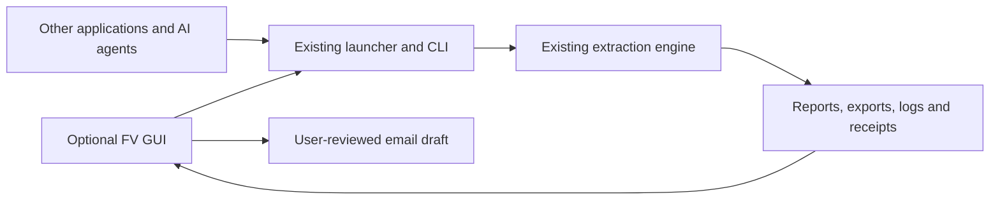

# Next release: minimal Field Viewer GUI

Date: 12 October 2026, America/Los_Angeles. Tracking: NEXT-29; incorporates
NEXT-13 branding and NEXT-27 optional diagnostic email.

The proposed GUI includes progress visuals, elapsed time, reliable percentages, input and output sizes, and direct links to reports and extracted data. The distribution design uses one repository and shared engine for two editions: Desktop includes the GUI and complete headless tools; Headless omits GUI files.

Status: **design draft; no GUI edition is published**. Implementation, package validation and independent clean-Windows acceptance remain separate gates. No new version number is assigned here.

## Decision and scope

The proposed design adds an optional desktop launcher around the existing headless tools.
The GUI selects inputs and options, starts the existing script in a separate
process, observes its recorded progress, opens results, and prepares diagnostic
email. It contains no extraction, conversion, scientific interpretation or QC
logic. Applications and AI agents continue using the same headless entry points
and output contracts without loading the GUI.

At implementation time, bind the engine to the exact published Field Viewer 1.0.0 package identified in [the public release notes](RELEASE_NOTES.md). Verify the package identity and chosen baseline. Preserve that engine's
files, runtime, defaults, CLI arguments, exit codes and output schemas. Editable
PaleoScan enhancements are a separate change and must not be silently included
in a GUI-only update. Proposed next version/build identity remains unassigned.

## One repository, two download editions

Use the existing `ahmedsahernouh/petrel-headless-extractor` repository. Maintain
the GUI in its own directory and reuse the existing scripts/runtime; do not
create a second repository, duplicate engine source or maintain divergent
GUI/headless branches. Engine fixes are maintained once and, when accepted for a release, included in both editions.

For the future release, prepare these assets together under one release/tag:

| Download edition | Intended use | Contents |
|---|---|---|
| **FieldViewer Desktop** | Interactive users | GUI launcher/assets plus the complete headless tools and shared engine/runtime. CLI and agent usage remain available. |
| **FieldViewer Headless** | Applications, AI agents and scripting | The identical engine/runtime and existing CLI, without GUI files or a GUI dependency. |

Illustrative asset names are `FieldViewer-Desktop-<version>-win64.zip` and
`FieldViewer-Headless-<version>-win64.zip`. `<version>` is a placeholder, not an assigned version bump. Both editions use the same product release version and
record the same engine build identity. If unchanged engine metadata carries the
preceding version/build, preserve it and distinguish it from the new outer
package release metadata; do not edit engine files merely to align labels.

Build the two editions from the same release source revision and one verified
engine bundle. Shared engine files must match byte for byte between editions and
against the chosen published baseline. Each ZIP has its own SHA-256 and complete
package manifest; the Desktop manifest additionally covers GUI files. Retain a
shared-engine manifest/hash so users and acceptance checks can verify equivalence
without assuming the two ZIP hashes should match. Include required runtime,
licenses, notices and usage instructions in each self-contained download.

The Desktop package adds a clearly named graphical launch shortcut while retaining
the existing BAT and command syntax. The Headless package retains the existing
headless entry point. Use separate extraction/install directories; do not require
one edition to be installed over the other. No automatic migration, uninstall or
replacement of an existing package belongs to this update.

The repository README and release notes should offer two prominent choices:
**Download Desktop (GUI + CLI)** and **Download Headless (CLI / AI agents)**,
with version, platform, checksum and a short selection explanation. Prefer
exact tagged asset links for pinned agent/integration dependencies; do not
silently move their downloads to a newer release. GitHub supports downloadable release assets:
[release management](https://docs.github.com/en/repositories/releasing-projects-on-github/managing-releases-in-a-repository)
and [release links](https://docs.github.com/en/repositories/releasing-projects-on-github/linking-to-releases).

Preserve the current release's tag, original assets, checksums and acceptance
records. For a future GUI release, assemble and verify both
editions before publishing it as a new release. A shared engine does not transfer
Desktop packaging/UI acceptance to Headless packaging, or vice versa; each
delivered archive must pass its own installation/launch checks. This plan creates
no repository, branch, tag, downloadable asset or public release.

## Smallest useful interface

One resizable window, keyboard accessible, with no wizard or embedded report
viewer. This is a planning sketch, not an implemented screen:

```text
+------------------------------------------------------------------------+
| [FV] Field Viewer Data Extractor                              [About]   |
| Reports: [Main report] [QC] [Diagnostics] [Other reports v] [View log]   |
| Folders: [All exports] [Seismic] [Wells] [Surfaces] [Other folders v]    |
|                                                                        |
| Petrel project: [exact .pet path.............................] [Browse] |
| Output folder:  [selected folder.............................] [Browse] |
| Mode: ( ) Report only   (*) Full extraction                     [Run]  |
|                                                                        |
| [Elapsed 00:00:00] [Input: Calculating...] [Output this run: --]         |
| Status: Ready   |   Current stage and latest recorded activity          |
| Stage progress: [.....................] Percentage when measurable      |
| [Stage status strip: pending / running / completed / gaps / failed]     |
|                                                      [Email last log] |
+------------------------------------------------------------------------+
```

- **FV logo:** reuse the specified white FV monogram on the blue/green rounded
  square from NEXT-13. Bundle it locally for the window and launcher icon; no
  external images/fonts, new logo design, or unverified registered-mark symbol.
- **Input:** select an exact `.pet` file and validate the matching same-stem
  `.ptd` directory. No automatic drive search or project copying. Direct ZGY
  selection stays available through the existing CLI; it is outside this small
  first GUI scope.
- **Output:** choose a writable directory outside the source-project directory.
  Show the full destination before Run. The backend retains authoritative path,
  capacity, source-integrity and runtime checks. Do not weaken them in the GUI.
- **Two exclusive modes:** Full extraction is the existing default. Report only
  requests the existing report/inventory/previews behavior without retained
  dataset conversion; it is not a promise of zero temporary work or instant
  execution. Neither label promises recovery of every native object.
- **Progress visuals and sizes:** compact elapsed/input/output cards, a current
  stage progress bar and a simple stage-status strip. Use recorded activity and
  meaningful denominators; the detailed measurement rules below prevent false
  percentages, misleading sizes or additional extraction work.
- **Reports and folders at the top:** keep two clearly labelled navigation rows
  visible without scrolling. Enable links as their exact run-bound targets become
  available. Open existing HTML in the default browser and folders in Explorer.
  For report-only/no exports, say so instead of offering broken or empty links.
  Preserve existing result pages and shortcuts.
- **About dialog:** product version, engine build revision, optional GUI revision,
  GitHub project, SaherLabs website, published support contact, Apache-2.0 license, NOTICE and
  third-party notices. Read version/build values from the packaged metadata;
  do not advertise an independently hardcoded version or universal support.

Use the packaged metadata for public project and support links. No link needs to be opened to run extraction offline.

## Progress dashboard and top navigation

Keep these visuals lightweight and operational: no new geological visualization,
map renderer or performance-analysis subsystem. Text accompanies status colors and
icons, including completed with gaps, so color is not the only signal.

### Timer and percentage

- **Elapsed timer:** update once per second during a run, using a monotonic clock
  for the active session. Show hours, minutes and seconds, adding days for long
  runs. Stop at the recorded terminal duration; reconnecting the GUI must not
  reset the original run timer. A separate latest-activity timestamp makes clear
  when the backend last advanced.
- **Current stage:** show the actual phase and object/operation when available,
  with a strip of recorded pending/running/completed/gaps/failed states. Do not
  invent a fixed stage count or treat skipped/unsupported work as decoded data.
- **Stage percentage when measurable:** use compatible completed/total counts
  from the same phase, for example bytes hashed out of known bytes, files copied
  out of the admitted inventory, or objects processed out of the known cohort.
  Label the unit and scope, such as `Hashing: 60% (6 of 10 GiB)`; this is an
  interface example. Object percentage measures
  processing, not recovery success, and unequal objects do not predict time.
- **Overall percentage:** show only if existing backend evidence provides a
  defensible whole-run denominator or documented weighting. Otherwise show
  `Overall progress: not available` and the current-stage bar/indeterminate
  indicator. Never compute it from stage number, elapsed time, output/input byte
  ratio, CPU activity or file growth. A phase reaching 100% does not mean the
  extraction or its QC is complete. No guessed ETA in this initial GUI.
- Unsupported/missing counters or partial event lines leave the indicator
  indeterminate, not 0% or a fabricated total. Preserve any existing backend
  measurement limitations; do not change the engine solely to obtain percentages.

### Input and output sizes

- **Input project size:** exact selected `.pet` plus its matching `.ptd` tree,
  using existing inventory metadata when available. Exclude neighboring projects.
  State this scope; separately show externally referenced seismic/companions only
  when resolved, readable and actually measured. Unavailable references remain
  `size unknown`, not zero and not part of a falsely complete project total.
- **Output folder size:** show `Output this run` prominently for this run's report,
  exports, logs and evidence. Also expose `Selected output folder total` in the
  size details, with a timestamp and an explicit note when it includes older or
  other runs. Never attribute a shared root's total bytes to the current run.
- Use human-readable units consistently (MiB/GiB) with exact bytes in details.
  Distinguish logical file lengths from allocated disk space. Output aliases and
  hard links must not be presented as additional physical storage: show a deduped
  file-data size when file identity is available, otherwise label the path sum as
  including aliases. Do not label either value `space used on disk` unless it is
  independently measured as allocated space. Input/output sizes do not measure
  recovered geological data or predict safe reclaimable space.
- Show `Calculating...`, `Partial`, `Unavailable`, or `Last measured at ...` when
  appropriate. Do not show zero while counting, and do not imply a changing-folder
  snapshot is an atomic final total. Temporary files may make live output size
  decrease; that alone is not a fault.
- Reuse backend inventories and incrementally observed metadata first. Any size
  scan runs asynchronously, at low frequency and only within the selected scope,
  with bounded work, caching and no overlapping scans. Avoid repeated full-tree
  scans during extraction, opening payloads or recomputing hashes for the GUI.
  Refresh from fresh evidence at terminal state; keep incomplete scans labelled.
  Counting inaccessible/network paths must not block Run, the UI or extraction.

### Reports and extracted-data shortcuts

- **Reports row, immediately below the FV header:** Main report, available QC
  report, Diagnostics and View log; an Other reports menu for additional existing
  per-run reports and source/receiving assessments. Distinguish the user report
  from an internal package report and label JSON-only evidence as JSON. Use the
  actual generated documents; a receiving assessment is not a completed import.
- Summary/detailed/visual links are shown only when those report variants exist
  for this run. Whole-application release-status dashboards must not be presented
  as the selected project's extraction reports. No new report generator is
  required just to populate this navigation.
- **Folders row:** All exports plus available category shortcuts, such as Seismic,
  Wells and Surfaces, with Other folders for points, polygons, workflows and other
  real categories. Where the exporter keeps well logs, heads and trajectories in
  separate folders, link them separately in the Wells menu instead of inventing a
  new combined directory. Include the selected output root and supporting-evidence
  folder with clear labels; do not reorganize or copy data for navigation.
- Resolve links through this run's receipts, result-access metadata and actual
  export index. Verify existence before opening. Disable missing/not-yet-generated
  links with a brief reason. Supported partial outputs can be opened with their
  recorded partial-run status; never elevate unfinished artifacts into accepted
  exports. Update targets when the run changes, never retain another run's links.
- These rows remain above the form and progress cards. Use labelled buttons with
  small icons, sensible wrapping at high DPI and keyboard access; important links
  must not be hidden behind a log console or require searching the output tree.

## Keep the engine independent



Proposed implementation: a small **Windows PowerShell / Windows Forms** front
end, using the Windows stack already required by the standalone launcher. This
avoids adding a browser server, Electron/Node runtime or Python GUI dependencies.
Package and clean-Windows compatibility remain untested. Microsoft's
[Windows Forms overview](https://learn.microsoft.com/en-us/dotnet/desktop/winforms/windows-forms-overview?view=netframeworkdesktop-4.8)
describes the native Windows desktop UI framework.

Add a separate, clearly named GUI shortcut/entry point beside the existing BAT.
Keep `FieldViewer_data_extractor.bat` and its argument behavior unchanged. Removing
the GUI must leave the headless application usable. Any small launcher or email
interop helper belongs to the GUI layer, with no dependency from the engine back
to it. Do not introduce a service, account, API server or new agent protocol.

The current `scripts/launch_standalone_petrel.ps1` already exposes the necessary
switches. Proposed argument mapping, subject to verification against the frozen
release baseline:

| GUI choice | Existing launcher arguments |
|---|---|
| Selected paths | `-ProjectFile <exact path> -OutputRoot <exact directory>` |
| Full extraction | `-CompanionMode convert` |
| Report only | `-ReportOnly` (launcher selects inventory internally) |
| Both modes | `-NoPause -FullHash -RunToCompletion` |

Supply paths as literal argument values with tested Windows quoting, never as
interpolated shell commands or `Invoke-Expression` text. No unit/CRS override,
hash bypass, changed conversion flag, timeout or automatic retry is added by
the interface. UI path validation is convenience; the backend makes admission
decisions. Run the same existing doctor/dependency checks.

Read `RUN_RESULT.json`, structured events and the existing per-run result-access
information. Preserve terminal distinctions: 0 completed, 10 completed with
gaps, 130 backend-handled cancellation, other nonzero values failure with the
actual code. A process exit without a valid expected receipt is not successful
extraction. Report UI/display/email failures separately from engine failures.

### Minimal process ownership

- Launch one engine run per GUI session. Disable repeated Run while active and
  focus/reuse an existing GUI instance instead of launching duplicate work.
- Keep execution off the UI thread. Redirect child streams to persistent files
  and display bounded tails so long logs cannot freeze the window or block the
  backend through undrained pipes.
- Bind a small GUI session record to exact executable, arguments, PID, creation
  time, output location and run identity. Locate results/logs only through that
  session and backend evidence, never by globally selecting the newest file.
- While active, closing the window offers to minimize and continue or keep it
  open. It does not kill the engine. An unexpected GUI crash must also leave the
  independently launched backend running and its logs usable. Reopening may
  reconnect only after checking the recorded process identity; never restart
  automatically from a stale PID. Reconnection is observation, not resume.
- No new Cancel/Pause/Resume feature in this release. Existing CLI behavior stays
  intact. Never terminate unrelated CLI or agent runs, or overwrite their output.

## Email last log for debugging

A small dialog shows the exact run/date/status, attachment filename/size,
recipient and an **optional explanation** box. Subject includes product version,
build and run ID. The normal latest log is currently named `*_LOG.txt`; do not
rename the engine's files just to use a `.log` extension.

Default action: prepare a closed sharing copy of that run's log and open a
user-reviewed mail composition window. Reuse the existing support ZIP's mapped,
successfully collected text-log member where available, retaining its identifier
replacement. Offer the existing `*_SUPPORT.zip` as an optional fuller diagnostic
attachment. Use `CONTENTS.json` roles and unavailable/incomplete entries; never
guess a ZIP member by list order or call an incomplete member a complete log.
If no redacted member exists, explicitly offer the original as **unredacted** for
review or allow the user to omit it. Do not silently substitute another run.

Original logs remain unchanged. Show a short review notice because paths, names
and free text may be sensitive and automatic redaction is not anonymity. Never
attach `.pet/.ptd`, seismic volumes, exported datasets, figures or credentials.
If selected while running, label any closed copy with its capture time as an
incomplete snapshot; do not stop extraction or collect a live file as final.

For a compatible configured Windows mail client, use Unicode Simple MAPI with
the composition dialog explicitly requested, attachment and optional message.
Microsoft's [MAPISendMailW documentation](https://learn.microsoft.com/en-us/windows/win32/api/mapi/nc-mapi-mapisendmailw)
supports attachments and user review, and documents cancellation, oversized
attachments and other failures. Client compatibility/architecture must be
checked rather than assuming all Outlook or webmail variants support this path.

Fallback: open an addressed email draft where possible, copy the recipient and
subject, and reveal the prepared attachment for manual attachment. Do not claim
that a `mailto:` link reliably attaches files. If no mail client is configured,
the user can use webmail with those same local files. No SMTP password storage,
embedded account, new cloud endpoint or automatic upload is included.

Sending is always initiated and reviewed by the user. Display precise outcomes:
draft opened, manual attachment required, cancelled, provider accepted, or failed;
never infer developer receipt from a mail-client return. Preserve the prepared
attachment if sending fails or exceeds the mail provider's limit; do not truncate
or upload elsewhere automatically. Email failure never changes extraction status
or blocks local reports. This plan sends no message.

## Future implementation sequence and acceptance

Proposed implementation sequence:

1. Freeze the actual published engine and list its CLI/output contracts and file
   hashes. Confirm the chosen Windows UI and email adapter on a disposable clean
   environment. If a required feature needs an engine change, report that scope
   conflict rather than quietly expanding the GUI-only release.
2. Add the isolated window, top report/folder navigation, path selectors, two
   modes, timer, measured progress and input/output size cards; then About and
   the reviewed email dialog. Add only GUI assets, helpers,
   packaging entries and documentation. Existing engine/source schemas stay intact.
3. Build separately identified Desktop and Headless candidate archives from the
   same source revision and verified engine bundle. Verify the acceptance gates
   below against the exact archives, retaining separate package checksums and
   receipts. Do not replace the current release or reuse its VM acceptance as
   proof of either new package. Publication remains a separate action.

| Gate | Required evidence |
|---|---|
| Engine isolation | All baseline engine/runtime hashes unchanged; no core imports GUI code; existing CLI and agent calls work without GUI files. |
| Edition parity | Shared engine/runtime manifests and file hashes match across Desktop and Headless and the published baseline. Desktop's additional files are confined to the GUI/package layer. Both archives carry correct release/engine identities, licenses and separate checksums. |
| Same behavior | Run CLI and GUI with identical options on bounded retained fixtures into separate destinations. Compare source hashes, artifact payload hashes, object outcomes, counts, QC and exit status. Normalize only documented run IDs/timestamps/paths, not real differences. |
| Both modes | Full extraction and report-only honor the mapped flags, retain the same full-hash default and report-only scope; unsupported layouts and explicit unknown units remain visible. |
| Paths and failures | Spaces, Unicode, shell metacharacters, supported UNC paths, missing `.ptd`, source-contained output, unwritable output, full disk and bootstrap failure give accurate outcomes without mutation or hidden prompts. |
| Lifecycle | Double-click/repeated Run cannot duplicate work; large logs keep the UI responsive; minimize and simulated GUI crash leave backend/logs intact; stale/PID-reused session cannot attach to an unrelated process. |
| Progress visuals | Timer survives reconnect and freezes at terminal duration; stage counters use matching units/cohorts; missing totals remain indeterminate; no false overall percent/ETA, and a completed phase is not reported as completed extraction. Status is readable without color. |
| Size display | Known fixture sizes, unresolved external references, incomplete scans, changing temporary files, hard-link aliases and a shared output root are labelled correctly. Size observation remains bounded and does not hash payloads or block extraction. |
| Result discovery | Top navigation opens only this run's actual reports and category folders; report-only, no exports, startup failure, missing receipts and not-yet-generated reports have honest unavailable states. Changing runs clears stale targets; high-DPI layout preserves visible top links. |
| Email | Correct run log, optional explanation, reviewed attachments, cancellation, no client, unsupported client, oversized attachment and incomplete collection. No automatic sending; use local/mock drafts unless a bounded test email is arranged. |
| Standalone UX | Independently extract and launch each exact archive on clean Windows as a standard user without Petrel/system Python. Desktop GUI and CLI work; Headless CLI works with no GUI files. Verify relocated offline packages, Desktop keyboard/tab order and DPI scaling, and package-matched About values/licenses/links. Use the bounded parity fixtures rather than repeating completed historical trials. |
| Download presentation | Two clearly distinguished edition links resolve to the intended tagged assets and checksums. No source-code archive is mislabeled as a standalone application download. |

No parser additions, changed numerical/scientific acceptance, 3D models,
PaleoScan/OpendTect integration, batch scheduler, automatic updater, account
system, data cleanup tool or new publishing operation belongs to this GUI scope.

## Source inspection for this plan

Read-only inspection on 12 October 2026 covered the existing BAT, standalone
PowerShell/Python launchers, result-access helper, support collector, toolkit
metadata, LICENSE and release backlog. These establish the adapter opportunities;
no GUI behavior or email compatibility was executed or validated.

Relevant source: `scripts/launch_standalone_petrel.ps1`,
`scripts/standalone_petrel_extract.py`, `scripts/geoviewer_result_access.py`,
`scripts/geoviewer_support.py`, `scripts/geoviewer_support.ps1` and `toolkit.json`.
Existing installed packages and user data remain
outside this documentation-only change.
